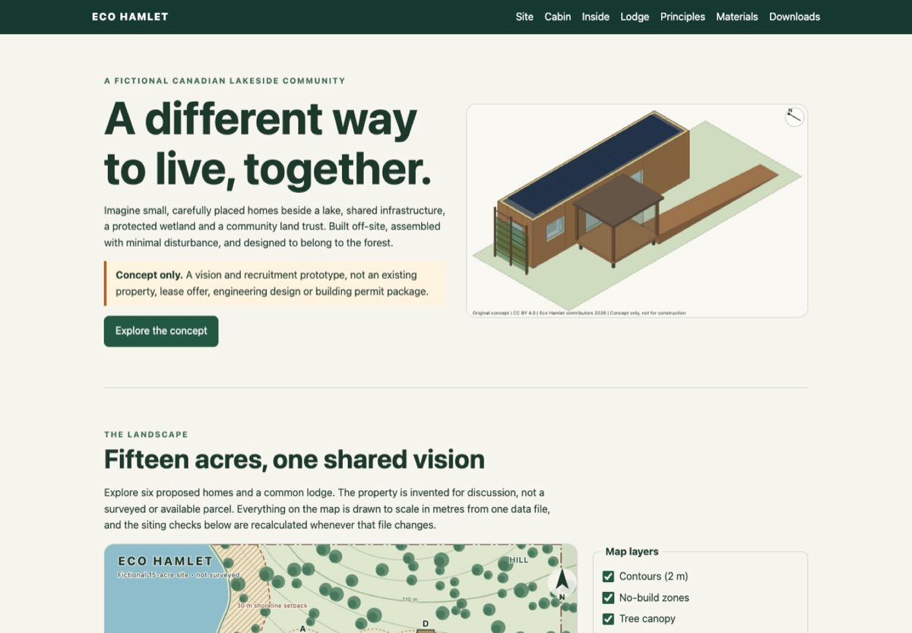
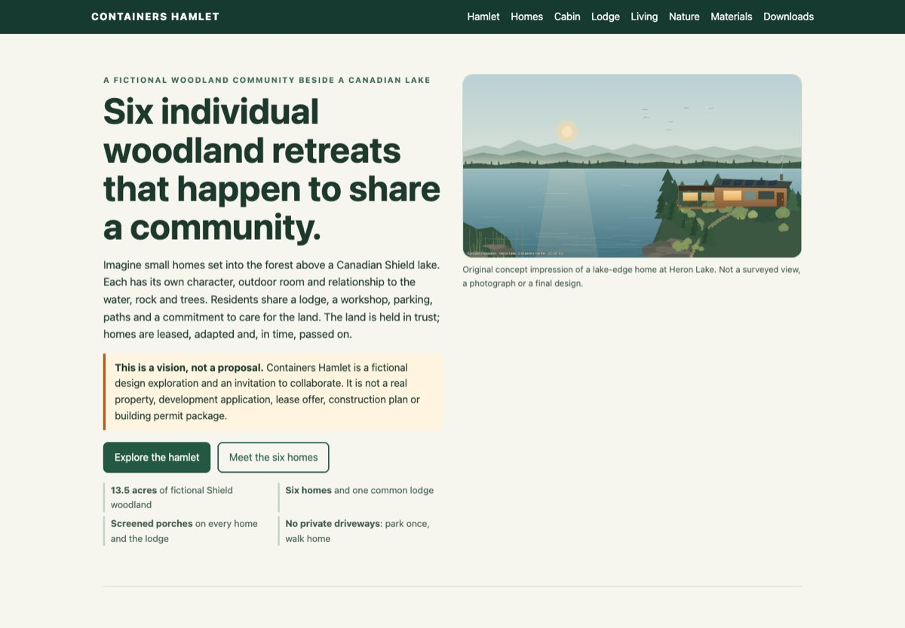
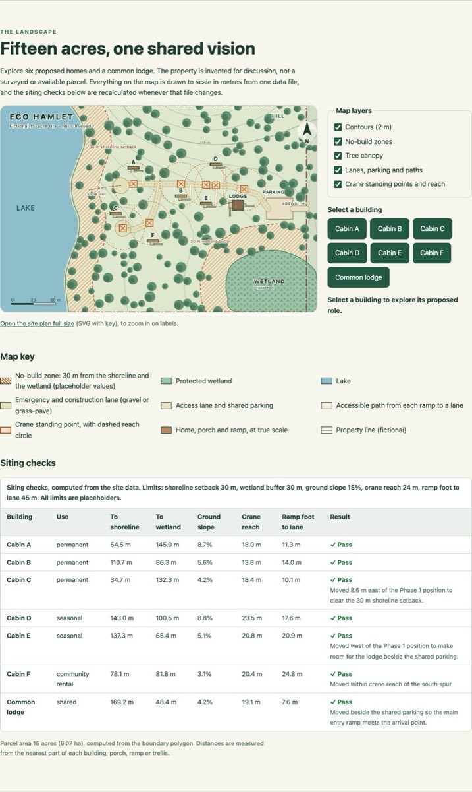
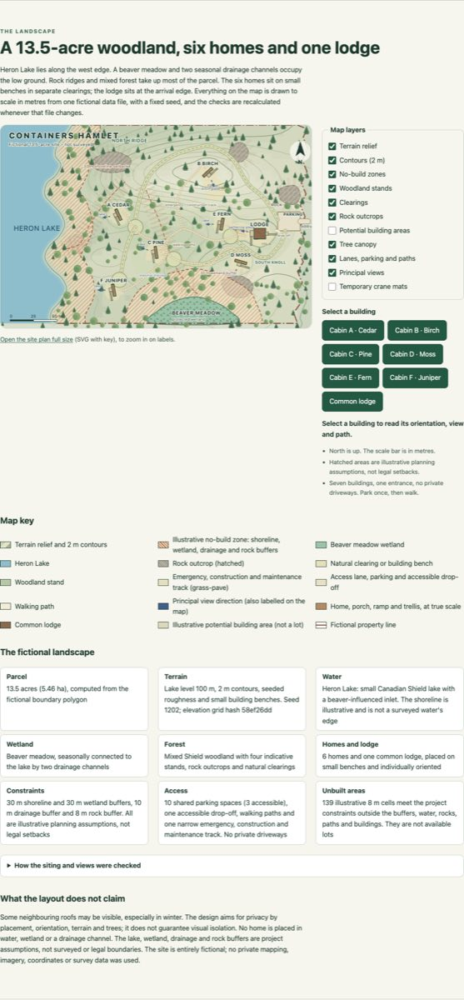
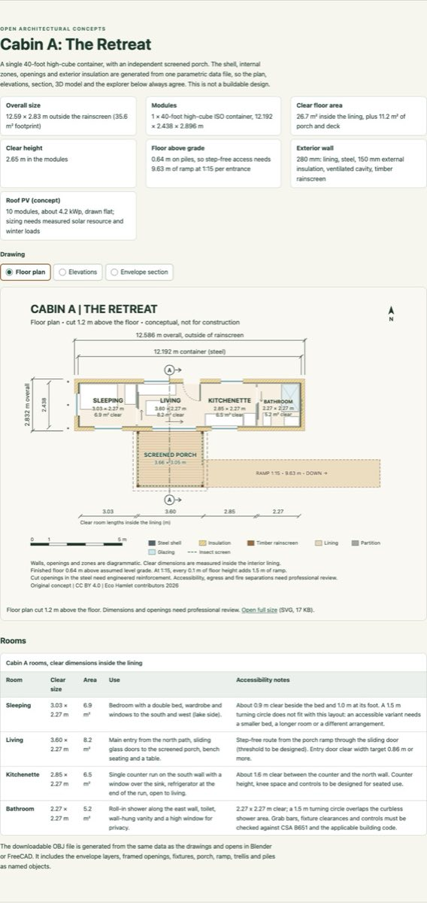
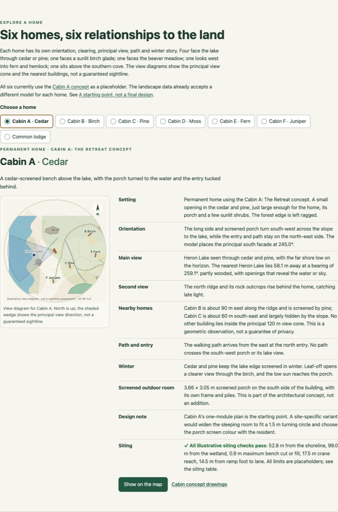
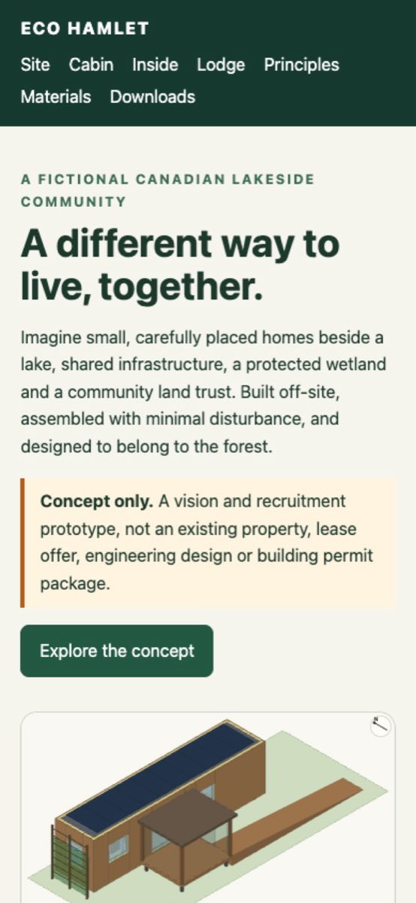
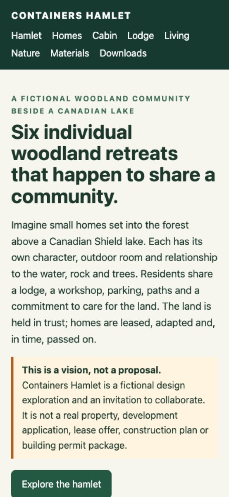

# Phase 1.2: audit, landscape, homes and validation

Containers Hamlet is a fictional 13.5-acre Canadian Shield community of six woodland retreats and one common lodge. Phase 1.2 replaces the flat 15-acre diagram with a written-description landscape, gives each home its own orientation, view, path and brief, and turns the map into an explorable hamlet. It preserves the existing Cabin A and lodge models, drawings, downloads, cutaway explorer and validation workflow.

This report records the baseline, the changes, the deliberate removals, the validation results, the remaining assumptions and the work that is explicitly deferred. Nothing here makes the concept surveyed, engineered, code-compliant, legally feasible or permit-ready.

## 1. Baseline before implementation

Baseline at commit `b77ddc2` on `main` (before the Phase 1.2 branch):

| Check | Result |
|---|---|
| `node tools/build.mjs --check` | 35 generated files up to date |
| `node tools/check.mjs` | 99 passed, 0 failed |
| `node tools/browser-check.mjs` | 52 passed, 0 failed in Chromium with axe-core 4.14 |
| First page view | 225 KB uncompressed, 59 KB gzipped, 8 requests |
| Whole published site | 1118 KB |
| Site | 15.0 acres, one flat-ish hill and hollow, six Cabin A homes all at rotation 0, one lodge |
| Homes | Identical footprint and orientation, no per-home view brief, no generated view diagrams |
| Map | Contours, buffers, trees, lanes, crane reach, buildings; no relief, woodland, rock, clearings, potential areas or view arrows |
| Content | Strong architecture and construction detail, but the first screen led with a single cabin rather than the landscape and community |

Baseline screenshots are in [`docs/screenshots/before/`](screenshots/before/): homepage, map, cabin, cutaway and mobile.

## 2. What Phase 1.2 delivers

### 2.1 A new fictional landscape

`data/site.json` now describes a 13.5-acre / 5.46 ha parcel generated only from the written description in the brief:

- **Heron Lake**, a small Shield lake with an irregular west shoreline and a beaver-influenced inlet.
- **Beaver meadow wetland** in the south, connected seasonally to the lake by two drainage channels.
- **Terrain**: a base rise from the shore, a north ridge, east ridge, south knoll, shore knoll, wetland basin, central swale, seeded roughness and small building benches.
- **Woodland**: four indicative stands (north pine/spruce, central mixed, south birch/cedar, shoreline cedar/pine), with conifer shares used for winter screening observations.
- **Rock outcrops**, natural clearings, a gathering glade and a birch glade.
- **Access**: one entrance, shared parking, an accessible drop-off, walking paths, two emergency spurs and a narrow emergency/construction/maintenance loop. No private driveways and no road to any home.
- **Buildings**: six homes and one lodge, each with a different rotation, clearing, principal view target, path approach, winter note and design note.

The terrain and tree scatter are deterministic. Seed `1202` fixes the roughness phases and tree positions; the 5 m elevation grid has hash `58ef26dd`. The build writes the grid and hash to `site/data/terrain.json` and `site/data/site-analysis.json`, and a static check rebuilds and compares it.

### 2.2 Home placements and orientations

Principal azimuth is the modelled screened-porch facade after rotation (clockwise from north). View bearing is to the nearest point of the named target. Alignment is the angular difference; the project tolerance is 55°.

| Home | Use | Rotation | Principal | Main target | View bearing | Alignment | Distance | Bench cut/fill | Natural slope | Shoreline | Wetland |
|---|---|---|---|---|---|---|---|---|---|---|---|
| Cabin A · Cedar | permanent | 65° | 245° | Heron Lake | 259.1° | 14.1° | 58.1 m | 0.87 m | 19.6% | 52.8 m | 99.0 m |
| Cabin B · Birch | permanent | −42° | 138° | Birch glade | 156.6° | 18.6° | 19.2 m | 0.64 m | 18.3% | 148.1 m | 126.9 m |
| Cabin C · Pine | permanent | 82° | 262° | Heron Lake | 286.6° | 24.6° | 101.2 m | 0.32 m | 5.2% | 95.7 m | 46.2 m |
| Cabin D · Moss | seasonal | 16° | 196° | Beaver meadow | 209.1° | 13.1° | 50.9 m | 0.23 m | 6.9% | 180.6 m | 45.6 m |
| Cabin E · Fern | community rental | 100° | 280° | Heron Lake | 269.7° | 10.3° | 167.0 m | 0.73 m | 14.7% | 161.0 m | 70.9 m |
| Cabin F · Juniper | seasonal | 80° | 260° | Heron Lake | 271.1° | 11.1° | 50.0 m | 0.58 m | 11.3% | 44.9 m | 47.0 m |
| Common lodge | shared | 0° | 270° | Gathering glade | 278.7° | 8.7° | 19.7 m | 0.34 m | 7.8% | 196.9 m | 71.0 m |

All seven buildings pass the illustrative checks: shoreline and wetland buffers, rock and drainage buffers, inside the parcel, natural slope under 22%, bench cut/fill under 1.6 m, crane reach under 24 m, ramp foot within 50 m of an emergency/access lane, and entry/ramp within 18 m of a walking path.

The mix is three permanent homes, two seasonal homes and one community rental, consistent with `docs/community-model.md`.

### 2.3 Views, privacy and winter

Each home has a generated **view diagram** (`site/assets/views/<id>.svg`) showing:

- the home footprint and porch, north up;
- the principal view cone (±30°) and the named target;
- the nearest lake, wet meadow, rock, woodland and clearings;
- other buildings within 140 m, with labels;
- nearby paths; and
- a text description and alt text.

The analysis derives the principal facade from the screened porch, compares it with the target bearing, samples three rays through the view cone, and reports the share of woodland, conifer and open ground plus a qualitative description. It also lists any building inside the 120 m view cone with its approximate bearing. This is supporting information. It is **not** a sightline study, a privacy score or a guarantee. The page says that some roofs may be visible, especially in winter.

Winter is considered in every brief: conifer stands hold their needles, deciduous stands open the view, and low winter sun reaches the south and west porches. The map supports view arrows labelled with their target, so the direction is not conveyed by colour alone.

### 2.4 Access without suburban roads

- **One entrance** from the fictional public road, at the east boundary.
- **Shared parking**: 10 spaces, 3 accessible, plus an accessible drop-off at the lodge.
- **Daily circulation**: walking paths branch from a west spine and a south spine. They approach each home from a non-view side. No path crosses a porch view or runs between a porch and the lake/wetland.
- **Emergency, construction and maintenance**: one narrow grass-pave loop with two short spurs and reinforced-turf turnarounds. It crosses the ridge drainage channel twice on proposed culverts. It is normally closed to daily traffic and is not designed to fire department standards here.
- **Crane**: temporary reinforced matting beside the track, no permanent crane pad. Lifts do not swing over the wetland or shoreline buffers.
- **Construction**: the layout explicitly distinguishes daily circulation from module delivery and emergency access. The page says a walking trail is not assumed to be sufficient for emergency response.

### 2.5 Improved explorer

- Terrain relief (a compact shaded-cell fill), 2 m contours, woodland stands, rocks, clearings, potential building areas, tree canopy, paths, emergency track, parking, view arrows, crane mats, homes and lodge.
- Layer checkboxes for 11 layers, with potential areas and crane mats hidden by default.
- Seven building buttons; selecting a building shows its use, orientation, main view, nearby homes, path, winter note and siting summary.
- The home selector is a native radio group. One home brief is shown at a time with the script; all seven are visible without it.
- "Show on the map" moves the map selection and focuses the matching button.
- The map details link to the full home brief; the home brief links back to the map.
- The map's `<desc>` now covers the lake, wetland, drainage, woodland, rock, access, view directions, building names and distances.

### 2.6 Content and public experience

New or rewritten sections:

- **Hero**: leads with “Six individual woodland retreats that happen to share a community”, the fictional status, the lake/forest/lodge/land-trust premise, and an original concept impression of a lake-edge home.
- **An ordinary morning**: the success criteria as a five-part narrative (waking, screened coffee, walking, lodge, returning).
- **Explore the hamlet**: the map, layers, key, landscape facts and a collapsible technical siting section.
- **Explore a home**: seven structured briefs with view diagrams, views, neighbours, paths, winter, screened porch, design note and siting.
- **Cabin**: preserved facts, drawings, elevations, section, floor plan and room table.
- **Look inside**: preserved cutaway and room explorer.
- **Common lodge**: preserved drawings, rooms and accessible facilities.
- **Living here**: permanent/seasonal/rental mix, land trust, shared infrastructure, autonomy, accessibility, participation, unresolved legal and financial questions, and an invitation to contribute.
- **Building with nature**: off-site fabrication sequence, reuse, external insulation, selective foam, green roofs/walls, solar/biosolar, screened porches, wetland protection, construction traffic, lighting and monitoring. It says explicitly that reused containers are not automatically better and that a real wetland assessment and approvals are needed.
- **Materials**: preserved provenance, material passport and reviews.
- **Adapt**: preserved models plus the data architecture, the future editor (documented, not built) and the deferred list.
- **Downloads**: landscape, terrain, home, drawing, 3D and data assets, licences, assumptions and the Phase 1.2 report link.

### 2.7 Architecture preserved

- `data/cabin-a.json` and `data/lodge.json` are unchanged.
- Floor plans, elevations, sections, axonometrics, cutaways, OBJ and MTL are still generated and downloadable.
- The cutaway/interior explorer still runs the same `model.js` and `render.js` as the generator.
- Material passports, provenance, reviews, room tables and the conceptual-design disclaimers are preserved.
- The building model is selected per homesite by the `model` field; the landscape does not assume identical footprints. All six homes currently reuse Cabin A as a stated placeholder, and each brief describes the site-specific variant that would replace it.

## 3. What changed or was removed, and why

| Change | Reason |
|---|---|
| The 15-acre parcel, lake shoreline, hill/hollow terrain and six rotation-0 placements were replaced | The brief asks for a new 13.5-acre Canadian Shield landscape generated from a written description, with organic placement and individual orientation. The old geometry remains in git history and is described in [`phase-1.1.md`](phase-1.1.md). |
| The old map key and “Fifteen acres” copy were replaced | They described the old site. The new key covers terrain, woodland, rock, clearings, potential areas, views and the two access types. |
| The hero image changed from the Cabin A axonometric to a generated concept impression | The brief asks the landscape and community to lead, before drawings and technical infrastructure. The cabin axonometric remains in the Adapt section and downloads. |
| Homes now have names, characters, rotations, view targets and paths | To make each home feel like an individual retreat and to support the view and privacy descriptions. |
| Lanes were replaced with a simpler entrance, walking network and narrow emergency loop | The old lanes passed close to homes and implied a road-led layout. The new layout separates daily circulation from emergency/construction access. |
| The siting table gained natural slope, bench cut/fill, rock distance, view alignment and terrain hash | To show the new terrain assumptions and make the view/siting claims traceable. |
| The old “Cabin C at its Phase 1 position” and “Cabin E in the wetland” regression tests were replaced | Those positions belong to the old geometry. New regression tests reject a shoreline setback, wetland siting, a route through the meadow, a path through the meadow, an overlapping building, an unknown model and a misaligned view. |

Nothing was removed from the architectural models, drawing set, downloads, licences, disclaimers, material passports or reviews. The Phase 1.1 report remains in the repository as project history.

## 4. Explicitly deferred

Phase 1.2 does **not** implement:

- a browser-based architectural editor;
- a sophisticated automated privacy optimiser;
- guaranteed visual privacy claims;
- detailed construction engineering;
- legal ground lease templates;
- rental booking systems;
- detailed financial projections;
- real property mapping or private geographic files;
- mandatory final housing designs;
- new backend infrastructure.

It also does not add new housing models yet. All six homes reuse Cabin A as a placeholder; the data architecture, `model` field, model registry, drawings pipeline and documentation support adding them, but the variants and their accessibility details remain future work.

## 5. Validation

### Static checks

`node tools/build.mjs --check` and `node tools/check.mjs`:

- **140 passed, 0 failed**.
- Generated files are current; data builds without errors.
- Parcel is **13.50 acres / 5.46 ha**.
- Terrain grid is reproducible; hash `58ef26dd` matches a fresh rebuild.
- Water, wetland and parcel polygons have valid vertices; woodland, rock, clearing and drainage data are present.
- 139 illustrative potential building cells are inside the parcel; they are not lots.
- Six homes and one lodge; at least four distinct orientations; every view target within tolerance; declared azimuth matches the modelled facade; every home has a canopy observation and winter note.
- No neighbour inside a principal view cone closer than 35 m.
- Every building passes shoreline, wetland, rock, drainage, parcel, natural slope, bench cut/fill, crane, lane and path checks.
- Removing a home leaves a valid six-building hamlet; an unknown model, overlapping buildings, a path/lane through the wet meadow, and a misaligned view are rejected.
- Existing geometry checks still pass: no intersecting solids, outward OBJ normals, plan/elevation/section dimensions consistent with the data, scale bars, section marks.
- SVG accessibility: title, description, role and unique ids for all generated drawings, view diagrams and the illustration.
- HTML: one h1, heading order, unique ids, labels, image dimensions/alt text, no forms/iframes/objects, local links, skip link, labelled sections, script-only controls hidden.
- Licences, attribution, privacy and page-weight budget.
- No private geographic data: local metres only; no latitude/longitude, KML, GeoJSON, EPSG/UTM coordinates or imported survey data.

### Browser checks

`node tools/browser-check.mjs` in Chromium:

- **62 passed, 0 failed**.
- axe-core WCAG 2.2 A/AA: no violations in the initial state, after interaction, at 320 px, in dark scheme, in forced colours or with scripts blocked.
- Full Tab walk: visible focus, nothing obscured, no trap.
- Keyboard operation of map selection, layers, home tabs, "Show on the map", map-to-brief links, drawing tabs, explorer building/mode/view/roof/show controls, room selection and roof option.
- Home brief switching updates the map, and the map details link opens the matching brief.
- View diagram alt text and actual image load.
- Reflow and text-spacing at 320 px; 24 px target size.
- Reduced motion, dark scheme and forced colours.
- No-JavaScript: all drawings, all seven home briefs, all seven view diagrams and all tables are present; script-only controls stay hidden.
- No third-party requests; every requested file and local link returns 200.

### Page weight

| Measure | Result |
|---|---|
| First view | 400 KB uncompressed, 98 KB gzipped, 8 requests |
| Whole published site | 1652 KB |

The first view includes the inline interactive map, the hero illustration, the page, scripts and data. It remains under the 120 KB compressed budget.

### Before and after

| Before (Phase 1.1) | After (Phase 1.2) |
|---|---|
|  |  |
|  |  |
|  |  |
|  |  |

Full sets: [`docs/screenshots/before/`](screenshots/before/) and [`docs/screenshots/after/`](screenshots/after/).

### What has not been validated

- No test with screen readers, voice control, magnification software, switch access or disabled people.
- No survey, lidar, hydrology, soils, geotechnical, wetland, species-at-risk, archaeology, title or planning review.
- No structural, envelope, fire, accessibility, mechanical, electrical or wastewater engineering.
- No legal review of the land trust, lease, rental or ownership model.
- No energy, embodied-carbon or cost model.
- The view diagrams and canopy observations are geometric approximations, not eye-height sightlines or seasonal field observations.

## 6. Remaining assumptions

- Container dimensions are typical published values for a 40-foot high cube. Actual units vary.
- Envelope thicknesses (150 mm external insulation, 25 mm cavity, 22 mm rainscreen, 200 mm roof insulation, 150 mm under-floor insulation) are placeholders, not energy modelling or code review.
- Ground is level under each building in the drawings. The site model has natural slopes up to 19.6% at the home footprints and assumes a bench of up to 0.87 m cut/fill. Real pile lengths, floor heights and ramp lengths will differ.
- Foundations are drawn as helical piles at a fixed layout. Type, number, depth and bearing are unknown, and piles are not automatically appropriate on rock or near wetlands.
- No-build buffers (30 m shoreline, 30 m wetland, 10 m drainage, 8 m rock), natural slope limit (22%), bench limit (1.6 m), crane reach (24 m), lane widths, parking count and path widths are placeholders, not regulatory values.
- The parcel runs to the water's edge. Many Canadian shorelines include a shore road allowance or Crown land.
- PV is drawn flat. Module size and power (1.134 × 2.278 m, 420 W) are typical values; kWp figures are counts, not energy yields.
- Accessibility notes are design intentions to verify against CSA B651 and the applicable code. Several rooms do not meet turning-space expectations, and the data says so.
- Material volumes are summed solid volumes for display, not a bill of quantities.
- The site is entirely fictional. No private property maps, KML files, coordinates, photographs or survey data were requested or used.

## 7. Reproducing the result

```sh
node tools/build.mjs --check      # generated files current
node tools/check.mjs              # 140 static checks
npm ci
npx playwright install chromium   # or set CHROMIUM_PATH
node tools/browser-check.mjs      # 62 browser checks
node tools/screenshots.mjs screenshots/after   # review screenshots
```

## 8. Pull request summary

This branch:

- replaces the 15-acre flat diagram with a reproducible 13.5-acre Canadian Shield landscape (Heron Lake, beaver meadow, drainage, woodland, rock, clearings, benches);
- re-places and individually orients six homes and the lodge, with named views, winter notes, paths, clearings and temporary crane mats;
- adds generated home briefs, view diagrams, a layered hamlet map and a generated concept illustration;
- preserves Cabin A, the lodge, all drawings, downloads, the cutaway explorer, material passports and reviews;
- rewrites the public narrative around the landscape, privacy, access, the land trust, construction with nature and adaptability;
- extends static and browser validation to 140 and 62 checks respectively, including terrain reproducibility, view alignment, fewer-than-six homes, paths, unknown models and no-JS home briefs;
- updates accessibility, data-model, build-strategy, vision and contributing documentation.

It deliberately does not add the architectural editor, a privacy optimiser, legal templates, rental booking, financial modelling, real mapping, final housing designs or a backend. It is ready for review, not merge.
